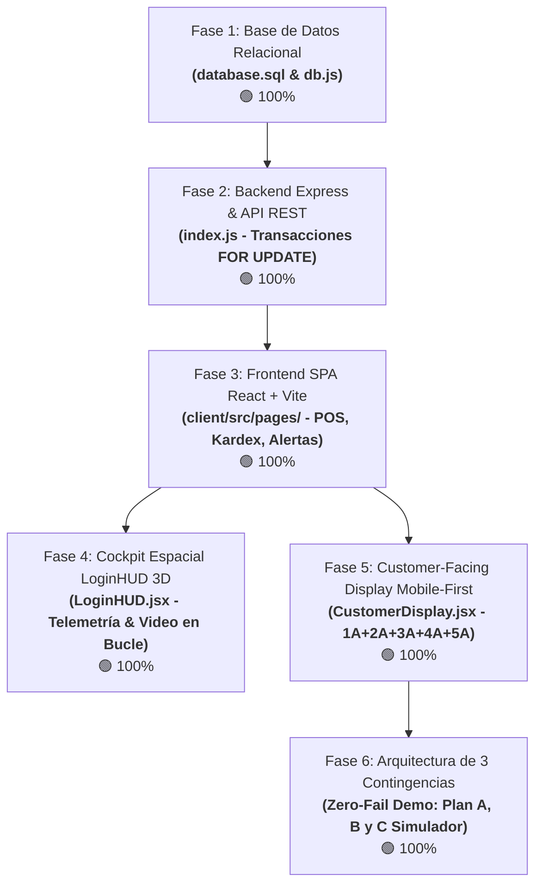
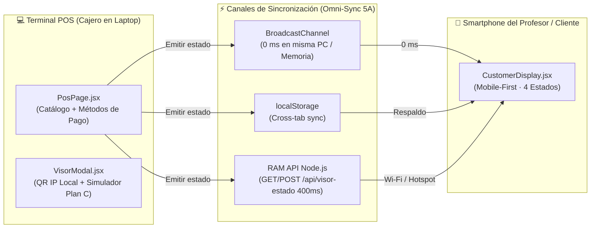

# PLAN INTEGRAL DEL PROYECTO: SISTEMA DE GESTIÓN DE INVENTARIO Y VENTAS
## BoticaNet+ (Botica Nova) — Software Web Fullstack & Customer-Facing Display

---

> [!IMPORTANT]
> ### 🚀 GUÍA RÁPIDA DE INSTRUCCIÓN PARA AGENTES IA (PROMPT TRIGGER)
> Cuando le pidas a tu compañero o a su agente de IA que trabaje en el frontend, dile exactamente:
> **`"Colega, por favor realiza las TAREAS REACT de PLAN.md"`**
> El agente leerá esta sección completa y ejecutará la migración y enriquecimiento del frontend en `client/`.

---

## ⚡ TAREAS REACT: ESPECIFICACIÓN Y MIGRACIÓN AL DIRECTORIO `client/`

### 🎯 1. Objetivo Principal
Migrar, estructurar y elevar a **nivel Awwwards** todo el frontend que se concibió inicialmente en `public/index.html` y `public/estilos.css`, transformándolo en componentes modulares de **React 19 + Vite** dentro del directorio **`client/`**.

El frontend debe abarcar de forma integral las **páginas y módulos clave** del sistema para el operador/vendedor:
1. **🛒 Página 1: Terminal POS** (`client/src/pages/PosPage.jsx`)
2. **⚠️ Página 2: Alertas de Stock** (`client/src/pages/AlertasPage.jsx`)
3. **📦 Página 3: Catálogo & Almacén (Inventario)** (`client/src/pages/InventarioPage.jsx`)
4. **🧾 Página 4: Comprobantes** (`client/src/pages/ComprobantesPage.jsx`)
5. **📊 Módulo 5: Kardex de Movimientos (Entradas y Salidas)** (`client/src/pages/KardexPage.jsx` o pestaña activa en Almacén)

Todas las páginas deben incorporar diseño clínico moderno (*Obsidian Slate* + *Clinical Emerald*), micro-interacciones a 60 FPS, atajos rápidos de teclado y alta intuitividad para el vendedor.

---

### 🛡️ 2. Requerimientos Funcionales Específicos para `client/`

#### A. 🔒 Abandono de Mostrador (Auto-Lock por Inactividad)
- **Comportamiento:** Si el operador no registra actividad (movimiento de mouse, pulsación de teclas, toques en pantalla o scroll) durante **2 minutos (120,000 ms)**, el sistema debe bloquear automáticamente la sesión activa.
- **Acción:** Remueve `botica_sesion_activa` de `sessionStorage` y regresa al **Cockpit Espacial 3D (`LoginHUD`)**.
- **Atajo manual:** El operador también puede bloquear la pantalla en cualquier momento presionando **`Alt + L`** o el botón `[🔒 Bloquear (Alt+L)]`.

#### B. 🛡️ Prevención de Inyección en Memoria y Fugas de Datos (Sin Autocompletado)
- En todos los formularios de autenticación, búsqueda de medicamentos, ingreso de DNI de cliente y registro de stock:
  - Configurar atributos estrictos: `autoComplete="off"`, `autoCorrect="off"`, `autoCapitalize="off"` y `spellCheck="false"`.
  - Evitar que navegadores o extensiones de terceros inyecten datos cacheados en campos sensibles de cobro o credenciales.

#### C. 💳 Flujo de Pago y Doble Botón de Emisión (Contingencia Zero-Fail en POS)
En `client/src/pages/PosPage.jsx`, el proceso de cobro debe contar con **dos botones independientes** para garantizar que la venta nunca se detenga:
1. **Botón 1: `[📱 Cobrar con Visor de Cliente]` (Flujo de Demostración y Simulación):**
   - Al presionarlo, envía el estado hacia la Pantalla del Cliente (`modo: 'PAGO_YAPE'` o `'PAGO_TARJETA'`).
   - El cliente en su pantalla móvil puede visualizar el QR / Radar NFC y cuenta con un botón interactivo para **"Simular Pago Realizado"**. Al pulsarlo, el visor emite la confirmación y avanza al Comprobante.
2. **Botón 2: `[⚡ Emisión Directa de Comprobante (Bypass)]` (Contingencia de Respaldo):**
   - Si la red falla, el celular se desconecta o no hay tiempo para la simulación, este botón **emite directamente la venta en el POS** mediante `POST /api/ventas` sin esperar confirmación del cliente ni depender de la sincronización.

#### D. 🖼️ Selector de Imágenes de Productos Existentes (Cero Cargas Nuevas en Almacén)
- Las imágenes de productos en alta resolución ya existen en el frontend en el directorio:
  `client/public/productos/`
  *(Archivos: `paracetamol.webp`, `amoxicilina.webp`, `ibuprofeno.webp`, `azitromicina.webp`, `omeprazol.webp`, `loratadina.webp`, `salbutamol.webp`, `alcohol.webp`, `termometro.webp`, `gasas_esteriles.webp`, `vitamina_c.webp`)*.
- **En la página de Catálogo & Almacén (`InventarioPage.jsx`):**
  - Al abrir el modal para agregar un nuevo medicamento, **NO se debe implementar subida de archivos multipart/form-data** para no generar almacenamiento en disco ni lógica innecesaria en el backend.
  - En su lugar, incluir un **Selector Visual de Imágenes** tipo carrusel o cuadrícula donde el farmacéutico selecciona una de las imágenes WebP ya existentes para asignarla al producto.

#### E. ⚠️ Indicador Claro y Semáforo Integral de Stock (3 Niveles)
- En el catálogo del POS (`PosPage.jsx`), en el inventario (`InventarioPage.jsx`) y en la página de alertas (`AlertasPage.jsx`):
  - Cada producto muestra con total claridad dos datos numéricos:
    1. **Stock Actual:** Número de unidades disponibles en anaquel.
    2. **Stock Mínimo:** Umbral de seguridad configurado (`Stock mín: X und.`).
  - Se aplica un **Semáforo Clínico de 3 Niveles** sobre todo el catálogo:
    - 🔴 **Rojo (`stock <= 15`):** Estado Crítico con lote sugerido de reposición inmediata.
    - 🟡 **Amarillo (`16 <= stock <= 30`):** Estado Medio / Preventivo de seguimiento.
    - 🟢 **Verde (`stock > 30`):** Abastecimiento Óptimo en anaquel.

#### F. 🌐 Despliegue en la Nube y Contingencia Local / Offline (Vercel + Render + Hotspot + PC)
El proyecto está preparado para ejecutarse bajo 3 escenarios posibles durante la sustentación:
1. **Escenario Nube (Vercel + Render):**
   - Frontend en Vercel (`vercel.json` + `apiBridge.js`) y Backend en Render (`process.env.DB_*` + `CORS_ORIGIN`) comunicándose por HTTPS.
   - *Tip:* Despertar el contenedor gratuito de Render 5 minutos antes de la exposición.
2. **Escenario Local Wi-Fi / Hotspot (Sin Internet en el Laboratorio):**
   - La laptop activa "Zona con cobertura inalámbrica móvil" (Hotspot de Windows).
   - El celular del profesor se conecta al Wi-Fi de la laptop y escanea el **QR generado 100% offline en SVG (`qrLocalMatrix.js`)** con la IP local detectada (ej: `http://192.168.137.1:5173/?visor=cliente`).
3. **Escenario Salva-Vidas en la Misma PC (Plan C - 100% Autónomo):**
   - Si no hay conexión posible ni celular disponible, el sistema corre de forma local completa en la laptop (`node index.js` + `npm --prefix client run dev`, o unificado en `http://localhost:3000` tras `npm --prefix client run build`).
   - El botón `[📱 Visor Cliente]` en el POS permite presionar `[🖥️ Abrir Visor Móvil en esta PC]`, abriendo una ventana flotante vertical al lado derecho sincronizada a **0 ms por `BroadcastChannel`**.

#### G. 📊 Módulo de Kardex: Trazabilidad de Entradas y Salidas en Tiempo Real
- **Objetivo:** Visualizar y auditar en la interfaz web todos los movimientos del inventario consumiendo el endpoint existente `GET /api/kardex`.
- **Requerimientos Visuales y Funcionales:**
  - **Tabla de Entradas y Salidas con Badges de Color:**
    - 🟢 `ENTRADA_COMPRA` / `ENTRADA_INICIAL`: Badge verde esmeralda con indicador `+X und.` (ingreso de mercadería al almacén).
    - 🔴 `SALIDA_VENTA`: Badge rojo o coral con indicador `-X und.` (salida automática generada al cobrar en el POS).
    - 🟡 `AJUSTE_MERMA`: Badge ámbar (bajas por deterioro o vencimiento de lote).
  - **Auditoría Matemática Precisa:** Mostrar en columnas contiguas: **Stock Anterior**, **Cantidad del Movimiento** y **Stock Posterior** para certificar que el stock del producto coincide exactamente con la suma y resta de sus movimientos.
  - **Motivo o Documento de Referencia:** Mostrar el número de comprobante de la venta (ej. *"Venta según Comprobante BOL-000101"*) o la referencia de la compra.
  - **Filtros de Trazabilidad:** Barra de búsqueda por nombre de medicamento y botones de filtro rápido (*Todos*, *Solo Entradas*, *Solo Salidas por Venta*).

---

## 0. LISTA DE FASES, REPARTO MODULAR Y ESTADO ACTUAL DE AVANCE



### Tabla de Estado y Cumplimiento de Fases:

| Fase del Proyecto | Estado | Responsables | Resumen Técnico de lo Implementado |
| :--- | :---: | :---: | :--- |
| **Fase 1: Base de Datos & Conexión** (`database.sql` & `db.js`) | 🟢 **100%** | Desarrollador A | Script DDL relacional con 7 tablas normalizadas (`categorias`, `vendedores`, `productos`, `lotes`, `ventas`, `detalle_ventas`, `movimientos_kardex`), seed de datos clínicos y pool asíncrono con `mysql2/promise`. |
| **Fase 2: Backend & API REST** (`index.js`) | 🟢 **100%** | Desarrollador B | Servidor Express con cabeceras OWASP, transacciones atómicas con `FOR UPDATE` y endpoints en memoria RAM para sincronización móvil (`GET/POST /api/visor-estado`). |
| **Fase 3: Frontend SPA** (`client/src/`) | 🟢 **100%** | Desarrollador B & A | Arquitectura SPA modular con **React 19 + Vite**, catálogo con fotos WebP, búsqueda instantánea, cálculo de IGV 18% y desglose de Op. Gravada. |
| **Fase 4: Cockpit Espacial LoginHUD 3D** | 🟢 **100%** | Desarrollador A | Fondo de video cinemático (`video1.mp4` / `video2.mp4`), telemetría de BD con radar activo, auto-shimmer en botón de inicio cada 4.5s y atajo `F9`. |
| **Fase 5: Customer-Facing Display (CFD)** | 🟢 **100%** | Desarrollador B | Pantalla de cliente *Mobile-First* con 4 estados (`IDLE`, `CARRITO`, `PAGO_YAPE`/`PAGO_TARJETA`, `COMPROBANTE` térmico con bordes dentados y QR SUNAT). |
| **Fase 6: Arquitectura Zero-Fail Demo** | 🟢 **100%** | Equipo | Modal de doble acción en el POS con generación de QR por IP local y botón para abrir **Simulador Móvil en la Misma PC (Plan C a 0 ms)**. |

---

## 1. CONTEXTO GENERAL DEL CASO PRÁCTICO

* **Organización:** Botica "Botica Nova" (Sistema: BoticaNet+).
* **Problema Operativo:** Quiebres de stock no previstos por control manual y demoras de 6 a 8 minutos por paciente en caja.
* **Solución Implementada:** 
  1. Terminal POS de alta velocidad con cálculo de vuelto en vivo y selección de métodos de pago (`Efectivo`, `Yape / Plin`, `Tarjeta`).
  2. Alertas automáticas de reposición para fármacos con $stock \le stock\_minimo$.
  3. Descuento atómico de existencias en MySQL con `START TRANSACTION` y `FOR UPDATE`.
  4. Pantalla de Cliente móvil para que el paciente o evaluador siga en vivo el despacho y el código de pago desde su smartphone.

---

## 2. ARQUITECTURA TÉCNICA Y SINCRONIZACIÓN OMNI-SYNC



---

## 3. ESPECIFICACIÓN DE LA PANTALLA DE CLIENTE (COMBINACIÓN 1A + 2A + 3A + 4A + 5A)

### 🌿 Estado 1: `IDLE` (Standby & Salud · 4A)
* Halo radial verde esmeralda superior sobre blanco porcelana.
* Isotipo médico animado con respiración suave.
* Baliza activa `● Caja 01 Disponible · Atención Inmediata` y reloj en tiempo real (`HH:MM AM/PM`).
* Carrusel automático de 3 consejos farmacéuticos rotando cada 5 segundos (genéricos bioequivalentes, control FEFO/DIGEMID y boleta con DNI).

### 🛒 Estado 2: `CARRITO` (Apple Wallet / Porcelain · 1A)
* Tarjetas de producto elevadas con animación elástica de resorte (`@keyframes cfdSpringDrop`).
* Micro-badge `✨ Registrado en caja` en el último medicamento añadido.
* Fotografía WebP nítida (`54x54px`), categoría terapéutica, píldora `x{cant} und.` y subtotal.
* Banner dinámico de efectivo y vuelto cuando el cajero digita el monto: `Efectivo entregado: S/ ...` ➔ **`Su vuelto: S/ ...`**.
* Dock inferior fijo con desenfoque de cristal (`backdrop-filter: blur(20px)`), desglose tributario y **Total a pagar** en tipografía monumental `2.15rem`.

### 💜 Estado 3A: `PAGO_YAPE` (Inmersión Pantalla Completa · 2A)
* Fondo púrpura/ciruela (`#742384`) y turquesa Plin (`#00d3b5`).
* Tarjeta central blanca con **Código QR SVG grande (220x220px)**.
* 4 esquinas de escaneo animadas con haz láser horizontal que sube y baja.
* Comercio verificado `✓ BOTICA NOVA S.A.C.` y monto exacto `S/ {total.toFixed(2)}`.
* Indicador inferior: `● Esperando confirmación de pago en caja...`.

### 💳 Estado 3B: `PAGO_TARJETA` (Terminal Contactless NFC · 2A)
* Fondo azul noche `#0f172a`.
* Ondas concéntricas animadas de radar NFC en esmeralda y cian.
* Monto monumental y leyenda interactiva *"Acerque su tarjeta o teléfono al terminal"*.

### 🧾 Estado 4: `COMPROBANTE` (Ticket Digital Térmico · 3A)
* Vibración háptica en smartphone (`navigator.vibrate([70, 40, 100])`) al confirmarse la venta.
* Ticket térmico blanco con **bordes dentados en zig-zag (CSS clip-path)**.
* Serie y correlativo `B001-XXXXX`, detalle de medicamentos, base imponible e IGV 18%.
* Código QR oficial de validación SUNAT.
* Botones de acción: `[📥 Imprimir / Guardar PDF]` y `[💬 Compartir por WhatsApp]`.

---

## 4. ARQUITECTURA DE LAS 3 CONTINGENCIAS (ZERO-FAIL DEMO)

```
┌────────────────────────────────────────────────────────────────────────┐
│ PLAN A (Nube / Vercel + Render):                                       │
│ • La laptop y el celular tienen acceso a Internet.                     │
│ • Ambos dispositivos se comunican mediante la URL pública en la nube.  │
├────────────────────────────────────────────────────────────────────────┤
│ PLAN B (Red Local / Hotspot de Windows - 100% Offline):                │
│ • No hay Internet en el laboratorio.                                   │
│ • La laptop activa "Zona con cobertura inalámbrica móvil" (Hotspot).   │
│ • El profesor se conecta al Wi-Fi de la laptop y escanea el QR con la   │
│   IP local detectada automáticamente (ej: http://192.168.137.1:5173).  │
├────────────────────────────────────────────────────────────────────────┤
│ PLAN C (Misma PC / Ventana Flotante Simulada - EL SALVA-VIDAS):        │
│ • El profesor no saca su celular o no hay conexión posible.            │
│ • Clic en [📱 Visor Cliente] -> [🚀 Abrir Simulador Móvil en esta PC]. │
│ • Abre una ventana vertical limpia (420x880px) al lado derecho.        │
│ • Sincronización a 0 ms vía BroadcastChannel sin depender de la red.   │
└────────────────────────────────────────────────────────────────────────┘
```

---

## 5. ESPECIFICACIÓN DE ENDPOINTS API REST (EXPRESS)

| Método | Ruta | Descripción | Payload / Respuesta |
| :---: | :--- | :--- | :--- |
| `POST` | `/api/login` | Autenticación de operadores en MySQL | `body: { usuario, clave }` ➔ `{ success, operador }` |
| `GET` | `/api/productos` | Catálogo ordenado con lote FEFO 1:1 | `[{ id_producto, nombre, categoria, precio, stock, stock_minimo, en_alerta }]` |
| `GET` | `/api/alertas` | Fármacos con $stock \le stock\_minimo$ | Catálogo filtrado por stock crítico |
| `POST` | `/api/productos` | Alta de medicamento + lote + Kardex | `body: { nombre, categoria, precio, stock, stock_minimo, ubicacion }` |
| `PUT` | `/api/productos/:id/stock` | Reabastecimiento rápido de stock | `body: { cantidad }` ➔ actualiza `productos`, `lotes` y `movimientos_kardex` |
| `POST` | `/api/ventas` | Transacción atómica de venta (`FOR UPDATE`) | `body: { cliente, metodoPago, items }` ➔ emite boleta `B001-XXXXX` |
| `GET` | `/api/ventas` | Historial de últimas ventas | `[{ id_venta, numero_comprobante, cliente, metodo_pago, total, fecha }]` |
| `GET` | `/api/ventas/:id` | Detalle completo de una venta | `{ venta: { id_venta, numero_comprobante, total, items: [...] } }` |
| `GET` | `/api/kardex` | Auditoría contable de movimientos | `[{ id_movimiento, producto, tipo_movimiento, stock_anterior, cantidad, stock_posterior }]` |
| `GET` | `/api/categorias` | Categorías farmacológicas | `[{ id_categoria, nombre, descripcion }]` |
| `GET` | `/api/lotes` | Lotes FEFO y ubicación en anaquel | `[{ id_lote, producto, codigo_lote, fecha_vencimiento, stock_lote, ubicacion_anaquel }]` |
| **`GET`** | **`/api/visor-estado`** | **Estado CFD en memoria RAM** | `{ modo, items, total, subtotalNeto, igv, metodoPago, vuelto, localIp }` |
| **`POST`** | **`/api/visor-estado`** | **Actualización CFD desde POS** | `body: { modo, items, total, ... }` ➔ `{ success: true, updatedAt }` |

---

## 6. GUÍA DE INSTALACIÓN Y PRODUCCIÓN

### 6.1 Instalación de Dependencias
```bash
# 1. Dependencias Backend
npm install

# 2. Dependencias Frontend React
npm --prefix client install
```

### 6.2 Modo Desarrollo (2 Terminales)
```bash
# Terminal 1: Backend Express (puerto 3000)
node index.js

# Terminal 2: Frontend Vite con soporte para red local (puerto 5173)
npm --prefix client run dev
```

### 6.3 Modo Producción (Build)
```bash
# Compilar bundle estático optimizado (servido automáticamente por Express en el puerto 3000)
npm --prefix client run build
```

---

## 7. CREDENCIALES Y ATAJOS DE SUSTENTACIÓN

* **Credenciales de Acceso:** Usuario: `vendedor` | Contraseña: `123`.
* **Atajo `F9`:** Auto-relleno de credenciales y login inmediato con sonido armónico.
* **Atajo `F2`:** Enfoque inmediato del buscador de medicamentos y lotes en el POS.
* **Atajo `F12`:** Emisión rápida de Boleta Electrónica en caja (abre el recibo térmico en el POS y en el Visor del Cliente).
* **Atajo `Esc`:** Cierra el modal de recibo en caja y deja lista la siguiente venta.
* **Atajo `Alt + L`:** Bloqueo inmediato de terminal POS y retorno al Cockpit 3D (también automático tras 2 min de inactividad).
* **Botón `[📱 Visor Cliente]`:** Despliega el modal de contingencia (QR 100% offline para celular y botón del simulador en PC).
* **Parámetro URL `/?visor=cliente`:** Acceso directo e incondicional a la pantalla del cliente en smartphones.
