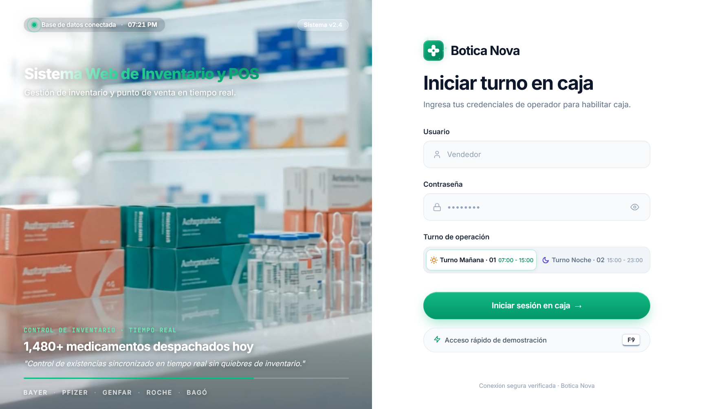
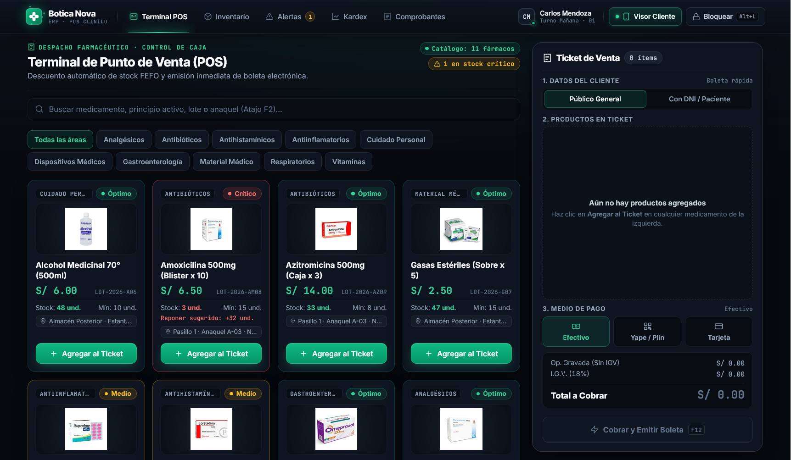
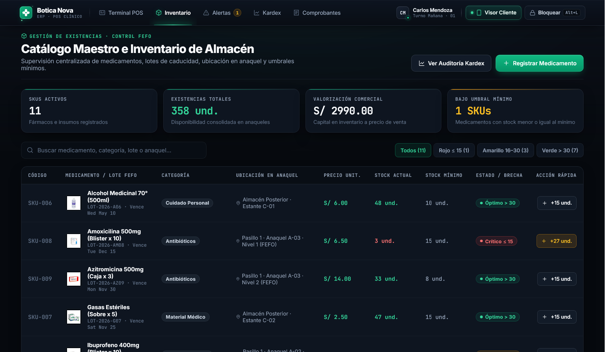
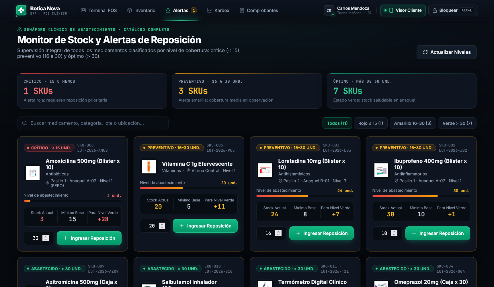
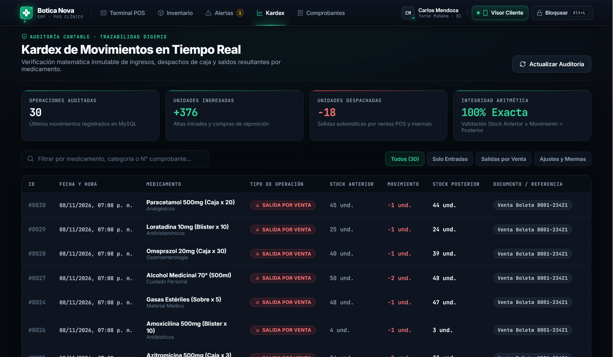
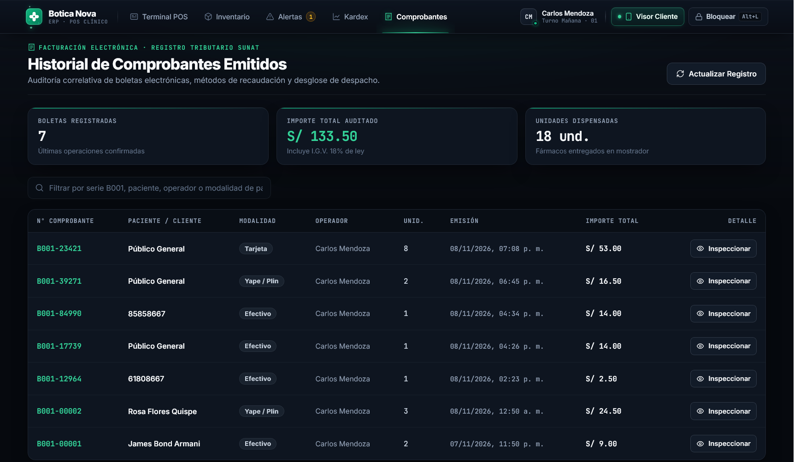
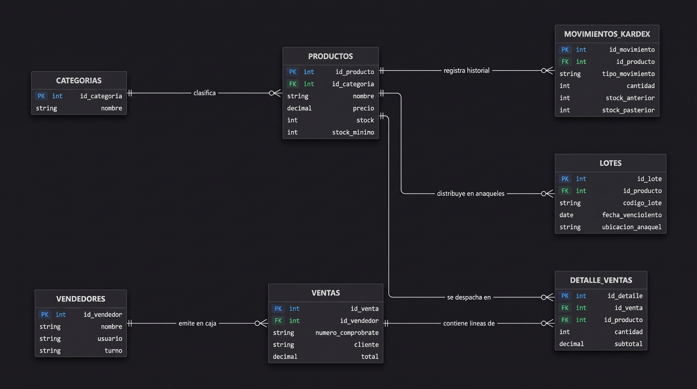

# 🏥 Botica Nova — Sistema Web de Gestión de Inventario y Ventas (BoticaNet+)
### ERP & Terminal POS Farmacéutico con Pantalla de Cliente Mobile-First (Customer-Facing Display)

---

## 🌟 Descripción General

**BoticaNet+ Nova** es una plataforma integral de gestión farmacéutica desarrollada para la botica **"Botica Nova"**. Resuelve de forma definitiva los problemas de desabastecimiento, quiebres de stock y demoras en caja mediante una arquitectura desacoplada y moderna:

* **Backend:** API REST en **Node.js + Express** con transacciones atómicas seguras en **MySQL** (`mysql2/promise`), soporte nativo para despliegue en la nube (`process.env.DB_*`, `CORS_ORIGIN`) y sincronización ultraligera en memoria RAM para dispositivos móviles.
* **Frontend:** Aplicación de alto rendimiento en **React 19 + Vite** (`client/`), con aceleración gráfica por GPU, semáforo clínico de inventario en 3 niveles (`<= 15` crítico, `16–30` medio, `> 30` óptimo), emisión inmediata de Boleta Electrónica SUNAT en caja y estética visual clínica de alta gama.
* **Customer-Facing Display (CFD):** Visor de cliente *Mobile-First* sincronizado en tiempo real con el Terminal POS para correr en el smartphone del profesor o en ventana simulada, con soporte para códigos QR reales (`yape.jpeg` y `plin.jpeg`) y generador QR de conexión 100% offline.

---

## 🎬 Flujo de Demostración para Sustentación (Paso a Paso)

Para una sustentación impecable frente al instructor o jurado, el ciclo operativo de venta en caja se ejecuta de forma fluida en este orden:

```
[ 1. Agregar Productos ] ➔ [ 2. Buscar DNI ] ➔ [ 3. Cobrar con Yape / Efectivo ] ➔ [ 4. Sincronización en Visor de Cliente ] ➔ [ 5. Imprimir Boleta ]
```

1. **📦 1. Agregar Productos:**
   - Haz clic en `+ Agregar al Ticket` en cualquier medicamento del catálogo (ej. *Amoxicilina*, *Azitromicina*, *Gasas Estériles*).
   - Observa cómo la lista del ticket se actualiza en el panel lateral derecho con scroll interno independiente, manteniendo la pantalla general completamente fija.
2. **🆔 2. Buscar DNI / Identificar Paciente:**
   - En la sección **1. DATOS DEL CLIENTE**, selecciona la pestaña **`Con DNI / Paciente`**.
   - Digita un DNI de 8 dígitos (ej. `72345678`, `45678912` o el DNI del profesor) y presiona **`Enter`** o haz clic en **`Buscar`**.
   - El número en el input se reemplaza de inmediato por el nombre oficial del paciente mediante el sistema **Híbrido Zero-Fail** (RENIEC Online + Contingencia offline).
3. **💳 3. Seleccionar Medio de Pago (Yape / Plin o Efectivo):**
   - Elige **`Yape / Plin`** (muestra el código QR con el monto exacto) o **`Efectivo`** (ingresa el monto recibido para calcular el vuelto exacto).
4. **📱 4. Mostrar la Sincronización en la Pantalla del Cliente:**
   - Muestra tu celular o la ventana del simulador: el cliente visualiza su orden en tiempo real, el desglose de IGV y el QR de pago sin latencia.
5. **🧾 5. Cobrar y Emitir Boleta:**
   - Presiona **`F12`** o haz clic en **`Cobrar y Emitir Boleta`**.
   - Se procesa la transacción atómica en MySQL (`FOR UPDATE`), se descuenta el stock FEFO, se registra el movimiento en Kardex y se abre la boleta digital térmica con opción de imprimir o compartir por WhatsApp.

---

## 🛡️ ARQUITECTURA DE CONEXIÓN DEL VISOR DE CLIENTE (MOBILE-FIRST)

> [!IMPORTANT]
> El sistema incorpora una conexión limpia e instantánea mediante **Cloudflare Tunnel (HTTPS Oficial)** junto con un simulador local de respaldo, eliminando configuraciones de red, puertos y bloqueos de Firewall:

```
┌────────────────────────────────────────────────────────────────────────┐
│ 🚀 MÉTODO PRINCIPAL: TÚNEL SEGURO HTTPS (Cualquier Smartphone)         │
│ • Ejecuta en terminal: npm run tunnel                                  │
│ • Genera un enlace público HTTPS (ej: https://xxxx.trycloudflare.com). │
│ • Abre el enlace en el smartphone del cliente (vía Wi-Fi o datos 4G/5G)│
│   o escanea el código QR desde el botón [👁 Visor Cliente].             │
│ • Cero configuraciones de Firewall, sin contraseñas y latencia mínima. │
├────────────────────────────────────────────────────────────────────────┤
│ 🖥️ MÉTODO ALTERNATIVO: SIMULADOR MÓVIL EN LA MISMA PC (0 MS)           │
│ • Si no se cuenta con un smartphone a la mano o para demo en proyector.│
│ • Clic en [👁 Visor Cliente] ➔ [Abrir en PC].                           │
│ • Despliega una ventana vertical emergente (420x880px) a la derecha.   │
│ • Sincronización instantánea a 0 ms por canal de memoria interna.      │
└────────────────────────────────────────────────────────────────────────┘
```

### ⚡ ¿Cómo conectar el smartphone en 2 simples pasos?
1. En tu PC, abre una terminal y ejecuta:
   ```bash
   npm run tunnel
   ```
2. En el Terminal POS, haz clic en el botón superior **`[👁 Visor Cliente]`** y escanea el código QR con la cámara de tu celular (o copia y abre el enlace HTTPS que arroja la terminal). Cada medicamento agregado, método de pago o vuelto en caja se sincroniza en vivo en el celular.

---

## 📱 Pantalla de Cliente Mobile-First (Customer-Facing Display)

Diseñada bajo estándares de concurso (Combinación 1A + 2A + 3A + 4A + 5A) para pantallas verticales de smartphones (`max-width: 480px; min-height: 100dvh`):

1. **🌿 Estado 1: `IDLE` (En Espera & Salud):**
   - Halo radial verde esmeralda, reloj en tiempo real (`HH:MM AM/PM`) y baliza activa `● Caja 01 Disponible`.
   - Tarjeta de bienvenida con respiración suave del isotipo médico.
   - Carrusel automático de 3 consejos farmacéuticos rotando cada 5 segundos (genéricos bioequivalentes, control FEFO/DIGEMID y boleta con DNI).
2. **🛒 Estado 2: `CARRITO` (Apple Wallet / Porcelain):**
   - Entrada física de resorte elástico (`@keyframes cfdSpringDrop`) para cada producto escaneado.
   - Resaltado especial con badge `✨ Registrado en caja` en el último producto ingresado.
   - Miniaturas nítidas WebP (`/productos/*.webp`), píldora `x{cant} und.`, precio y subtotal.
   - Banner dinámico cuando se recibe efectivo: `Efectivo entregado: S/ ...` ➔ **`Su vuelto: S/ ...`**.
   - Dock inferior fijo con desenfoque de cristal (`backdrop-filter: blur(20px)`), desglose de Op. Gravada, IGV 18% y **Total a pagar** en tipografía monumental `2.15rem`.
3. **💜 Estado 3A: `PAGO_YAPE` (Inmersión Pantalla Completa · QR Reales Yape / Plin):**
   - Selector interactivo **`QR Yape` | `QR Plin`** con transición automática entre fondo púrpura (`#742384`) y azul/turquesa Plin (`#00d3b5`).
   - Carga directa de los códigos QR oficiales (`client/public/qr/yape.jpeg` y `plin.jpeg`) con respaldo vectorial automático.
   - Esquinas de encuadre y haz láser horizontal animado que sube y baja.
   - Comercio verificado `✓ BOTICA NOVA S.A.C.` y monto exacto en tipografía gigante.
4. **💳 Estado 3B: `PAGO_TARJETA` (Terminal Contactless NFC):**
   - Fondo azul noche obsidiana (`#0f172a`), ondas de radar NFC concéntricas animadas en esmeralda y cian, monto exacto e instrucción interactiva.
5. **🧾 Estado 4: `COMPROBANTE` (Ticket Digital Térmico en Visor y en Caja POS):**
   - Apertura instantánea del **Recibo Térmico SUNAT** tanto en la pantalla del cajero (`PosPage.jsx`) como en el smartphone del cliente (`CustomerDisplay.jsx`).
   - Vibración háptica en smartphones (`navigator.vibrate([70, 40, 100])`) al confirmarse el cobro.
   - Ticket digital de papel blanco con **bordes dentados en zig-zag (CSS clip-path)**, serie correlativa `B001-XXXXX`, desglose de Op. Gravada, IGV 18%, efectivo recibido/vuelto, QR SUNAT y botones para **Imprimir/PDF** (`@media print` limpio) y **Compartir por WhatsApp**.

---

## 🔐 Cockpit Espacial de Autenticación (`LoginHUD`)

* **Video Cinemático en Bucle:** Alternancia suave entre videos de fondo (`video1.mp4` y `video2.mp4`).
* **Telemetría de Base de Datos en Vivo:** Píldora de cristal escarchado con radar de ondas activo (`@keyframes radarPing`) e indicador de estado de conexión y reloj tabular sincronizado.
* **Brillo Automático del Botón:** Destello *shimmer* que cruza el botón de inicio de sesión automáticamente cada 4.5 segundos y al pasar el cursor.
* **Atajo F9 de Demostración Rápida:** Rellena las credenciales con efecto de mecanografía y accede al sistema en 1 segundo.

<p align="center">
  
</p>

---

## 🖥️ Módulos Operativos del Sistema (Capturas de Pantalla)

### 1. Terminal de Punto de Venta (POS Clínico)
* Despacho farmacéutico ágil con atajos de teclado (`F2` buscador, `F12` cobro inmediato).
* Búsqueda híbrida de DNI / Paciente con verificación RENIEC Online y contingencia offline.
* Descuento atómico de inventario en MySQL (`FOR UPDATE`), panel lateral de ticket con scroll interno aislado y sincronización en vivo con la Pantalla del Cliente.

<p align="center">
  
</p>

---

### 2. Gestión de Inventario Farmacéutico (Control FEFO)
* Catálogo con semáforo visual de existencias (Crítico `<= 15`, Medio `16–30`, Óptimo `> 30`).
* Control estricto de lotes, fecha de vencimiento y ubicación física en anaqueles para cumplimiento DIGEMID.
* Modal reactivo de reabastecimiento rápido de stock sin recargar la página.

<p align="center">
  
</p>

---

### 3. Semáforo de Alertas y Stock Crítico
* Panel de telemetría que detecta automáticamente medicamentos por debajo del stock de seguridad.
* Sugerencia calculada de unidades de reposición para evitar desabastecimiento.
* Acceso directo a reabastecimiento en un solo clic.

<p align="center">
  
</p>

---

### 4. Kardex y Trazabilidad de Almacén
* Historial de auditoría inmutable de todas las entradas (compras) y salidas (ventas en caja).
* Balance de saldos matemáticos con fecha, hora, tipo de movimiento, lote y usuario responsable.
* Filtros por medicamento y cálculo instantáneo de saldos contables.

<p align="center">
  
</p>

---

### 5. Comprobantes Electrónicos y Consulta Fiscal
* Registro fiscal de boletas electrónicas emitidas serie `B001-XXXXX`.
* Desglose de Operación Gravada, IGV (18%) y total recaudado en Soles (PEN).
* Modal de recibo térmico con código QR SUNAT, impresión limpia y opción de compartir por WhatsApp.

<p align="center">
  
</p>

---

## 🗄️ Modelo y Diseño de la Base de Datos (`botica_net_db`)

El sistema cuenta con una arquitectura relacional normalizada de **7 tablas** para asegurar consistencia en ventas, control de vencimiento de medicamentos (**FEFO**), ubicación rápida en anaqueles y auditoría de Kardex en tiempo real:

<p align="center">
  
</p>

---

## 🚀 Guía de Instalación y Puesta en Marcha

### Paso 1: Requisitos Previos
* **Node.js** (v18 o superior): [https://nodejs.org](https://nodejs.org)
* **MySQL Server** (mediante **XAMPP**, WampServer o servicio nativo).

---

### Paso 2: Importar la Base de Datos
En tu gestor de base de datos MySQL (o phpMyAdmin):
1. Asegúrate de que el servicio MySQL esté corriendo.
2. Importa el archivo `database.sql` en la raíz del proyecto:
   ```bash
   mysql -u root -p < database.sql
   ```
*(Si usas XAMPP sin contraseña, presiona `Enter` cuando solicite password).*

---

### Paso 3: Instalar Dependencias (Raíz y Cliente)
Abre una terminal en la raíz del proyecto y ejecuta:

```bash
# 1. Instalar dependencias del Backend (Express, MySQL2)
npm install

# 2. Instalar dependencias del Frontend (React, Vite, Router)
npm --prefix client install
```

---

### Paso 4: Iniciar el Proyecto (Backend y Frontend en Puertos Separados)

El sistema opera bajo una arquitectura desacoplada con dos puertos especializados:

| Servicio | Puerto Local | ¿Qué se muestra exactamente en el navegador? |
| :--- | :---: | :--- |
| **Backend (Node.js + Express)** | `http://localhost:3000/` | **Explorador JSON de la API REST:** Muestra el estado en vivo del servidor, la confirmación de conexión a MySQL (`botica_net_db`) y el catálogo interactivo de los 13 endpoints documentados con sus métodos HTTP (`GET`, `POST`, `PUT`) y payloads para pruebas rápidas de backend. |
| **Frontend (React 19 + Vite)** | `http://localhost:5173/` | **Aplicación Clínica Completa (SPA):** Interfaz gráfica de usuario que incluye el Cockpit 3D de Login (`LoginHUD`), Terminal POS de ventas, Catálogo con fotos WebP, Alertas de stock crítico con semáforo, Comprobantes fiscales y la página de **Kardex** con trazabilidad matemática. Además cuenta con soporte de red local (`--host`) para abrirse en celulares. |

---

#### ⚡ Opción A: Modo Automatizado (1 Solo Comando — Altamente Recomendado)

Para mayor comodidad durante el desarrollo o la sustentación, no necesitas abrir múltiples terminales. Abre **una sola ventana de terminal** en la raíz del proyecto y ejecuta:

```bash
npm run dev
```

* **¿Cómo funciona internamente?:** Utiliza `concurrently` para lanzar en paralelo el backend y el frontend.
* **Salida en consola:** Verás los logs de ambos servicios en la misma pantalla con prefijos de colores diferenciados:
  - `[API]` (en verde): Muestra el arranque del servidor Node.js y la conexión con MySQL en el puerto `3000`.
  - `[VITE]` (en cian): Muestra el servidor de desarrollo de React en el puerto `5173` y la IP local para smartphones.
* **Detención rápida:** Al presionar `Ctrl + C`, ambos servidores se apagan de forma limpia y simultánea.

---

#### 🛠️ Opción B: Modo Tradicional (Dos Terminales Separadas)

Si prefieres monitorear o depurar cada proceso en su propia consola independiente, puedes iniciarlos por separado:

1. **Terminal 1 — Servidor Backend (API REST en Puerto 3000):**
   ```bash
   npm start
   ```
   *Salida esperada:*
   ```text
   [SERVER] Sistema ERP/POS Botica Nova activo en http://localhost:3000
   [DB] Conexión verificada con MySQL (botica_net_db)
   ```
   *Al ingresar a `http://localhost:3000/` en tu navegador podrás visualizar el JSON de estado y rutas del backend.*

2. **Terminal 2 — Servidor Frontend (React + Vite en Puerto 5173):**
   ```bash
   npm run client
   ```
   *Salida esperada:*
   ```text
     VITE v8.3.5  ready in 280 ms

     ➜  Local:   http://localhost:5173/
     ➜  Network: http://192.168.1.XX:5173/
   ```
   *Al ingresar a `http://localhost:5173/` accederás a la interfaz gráfica completa del sistema.*

---

### Paso 5: Conectar el Smartphone en Tiempo Real (Cloudflare Tunnel · Auto-Sync)

Para proyectar la **Pantalla de Cliente Mobile-First** en cualquier teléfono (vía Wi-Fi o datos móviles 4G/5G) sin restricciones de red ni permisos de Administrador en el Firewall de Windows:

Abre una **segunda ventana de terminal** en la raíz del proyecto y ejecuta:

```bash
npm run tunnel
```

*Salida esperada en consola:*
```text
===================================================================
🚀 BOTICA NOVA · CLOUDFLARE TUNNEL (AUTO-SYNC)
Iniciando túnel seguro HTTPS para el Visor de Cliente Mobile-First...
===================================================================

===================================================================
✅ ¡TÚNEL CONECTADO Y SINCRONIZADO AUTOMÁTICAMENTE!
📱 Enlace para Smartphone: https://xxxx-xxxx-xxxx.trycloudflare.com/?visor=cliente
⚡ El código QR en el POS ya está actualizado sin tocar nada.
===================================================================
```

#### 🪄 ¿Cómo funciona la sincronización 100% automática?
1. **Detección inteligente:** El script (`scripts/tunnel.js`) captura al vuelo el nuevo subdominio asignado por Cloudflare en cualquier PC.
2. **Sincronización en caliente:** Notifica automáticamente al backend (`/api/tunnel-url`) y guarda la sesión en `tunnel.json`.
3. **Escaneo instantáneo:** En la PC vas a **`[👁 Visor Cliente]`**; el código QR y el enlace ya se habrán actualizado solos sin que tengas que copiar, pegar o editar nada manualmente. Solo escaneas con el celular y comienzas la demostración.

---

### Paso 6: Compilación para Producción y Despliegue en la Nube (Build)
Si deseas generar la versión optimizada para producción o servir todo el sistema unificado desde `http://localhost:3000`:
```bash
npm --prefix client run build
```
Los archivos optimizados se generan en `client/dist/` y son detectados automáticamente por `index.js`. Para entornos cloud (Vercel + Render/Railway), el sistema soporta variables de entorno (`DB_HOST`, `DB_USER`, `DB_PASSWORD`, `DB_NAME`, `DB_PORT`, `DB_SSL`, `CORS_ORIGIN` y `VITE_API_URL`).

---

## ⌨️ Atajos de Teclado y Credenciales de Demostración

| Atajo / Credencial | Acción / Función |
| :---: | :--- |
| **`vendedor` / `123`** | Credenciales oficiales de acceso al sistema en `LoginHUD`. |
| **`F9`** | **Auto-Login Demostrativo:** Escribe automáticamente las credenciales y accede a caja. |
| **`F2`** | **Búsqueda Rápida en POS:** Enfoca de inmediato el buscador de medicamentos y lotes. |
| **`F12`** | **Cobro Rápido en Caja:** Emite la Boleta Electrónica SUNAT y abre el recibo térmico. |
| **`Esc`** | **Cierre Universal de Modales:** Cierra inmediatamente cualquier ventana emergente activa (Recibo de caja, Modal de Visor QR, Alta de medicamento o Detalle de boleta). |
| **`Alt + L`** | **Bloqueo Inmediato:** Bloquea la sesión del cajero y regresa al cockpit 3D (también se activa tras 2 min de inactividad). |
| **`[👁 Visor Cliente]`** | Abre la ventana de sincronización móvil con código QR de Cloudflare Tunnel y simulador en PC. |
| **`/?visor=cliente`** | URL directa para cargar la Pantalla de Cliente en cualquier smartphone. |

---

## 🔌 Especificación Completa de la API REST (12 Endpoints)

| Método | Endpoint | Descripción | Estado HTTP |
| :---: | :--- | :--- | :---: |
| `POST` | `/api/login` | Autenticación de operadores contra la tabla `vendedores` en MySQL. | `200 OK` |
| `GET` | `/api/productos` | Catálogo completo con join FEFO 1:1 de lotes y ubicaciones. | `200 OK` |
| `GET` | `/api/alertas` | Medicamentos con stock crítico ($stock \le stock\_minimo$). | `200 OK` |
| `POST` | `/api/productos` | Alta de nuevo medicamento con lote inicial y asiento en Kardex. | `201 Created` |
| `PUT` | `/api/productos/:id/stock` | Reabastecimiento rápido de existencias con registro en Kardex. | `200 OK` |
| `POST` | `/api/ventas` | Emisión de boleta con descuento atómico (`FOR UPDATE`) y Kardex. | `201 Created` |
| `GET` | `/api/ventas` | Historial correlativo de las últimas boletas emitidas. | `200 OK` |
| `GET` | `/api/ventas/:id` | Detalle fiscal y líneas de fármacos de un comprobante. | `200 OK` |
| `GET` | `/api/kardex` | Bitácora contable de entradas, salidas por venta y mermas. | `200 OK` |
| `GET` | `/api/categorias` | Listado de categorías terapéuticas activas. | `200 OK` |
| `GET` | `/api/lotes` | Control de lotes FEFO, fechas de vencimiento y anaqueles. | `200 OK` |
| **`GET/POST`** | **`/api/visor-estado`** | **CFD Omni-Sync:** Sincroniza en RAM carrito, QR, vuelto y boleta + IP local. | `200 OK` |

---

## 📁 Estructura del Código

```text
Botica_Net/
│
├── index.js                      # Backend Express, 12 endpoints REST, CORS y servidor SPA
├── db.js                         # Pool MySQL asíncrono (soporta XAMPP local y variables Cloud)
├── database.sql                  # DDL de 7 tablas relacionales y catálogo clínico inicial
├── package.json                  # Dependencias y scripts del servidor backend
├── README.md                     # Manual integral de arquitectura, instalación y uso
├── PLAN.md                       # Plan maestro de fases, requerimientos y contingencias
│
├── img/                          # Diagramas y capturas del sistema (db_design.jpg, etc.)
│
└── client/                       # Frontend SPA (React 19 + Vite)
    ├── package.json              # Dependencias y scripts del frontend (vite, build, lint)
    ├── vite.config.js            # Configuración de proxy /api y host para red local
    ├── vercel.json               # Reglas de reescritura SPA para despliegue en Vercel
    ├── public/
    │   ├── favicon.svg           # Isotipo oficial de Botica Nova
    │   ├── video1.mp4            # Video cinemático diurno de farmacia
    │   ├── video2.mp4            # Video cinemático de anaqueles
    │   ├── qr/                   # Códigos QR reales de recaudación (yape.jpeg y plin.jpeg)
    │   └── productos/            # 11 fotografías WebP verificadas en alta resolución
    └── src/
        ├── App.jsx               # Enrutador, watchdog de inactividad (2 min) y ?visor=cliente
        ├── App.css               # Sistema de diseño clínico, recibo térmico e impresión limpia
        ├── pages/
        │   ├── PosPage.jsx       # Terminal POS con Ticket de 5 pasos, Boleta en Caja y Omni-Sync
        │   ├── AlertasPage.jsx   # Semáforo completo (<=15 Rojo, 16-30 Amarillo, >30 Verde)
        │   ├── InventarioPage.jsx # Catálogo maestro FEFO y alta con selector visual WebP
        │   ├── KardexPage.jsx    # Auditoría contable de entradas, salidas y saldos
        │   └── ComprobantesPage.jsx # Historial correlativo SUNAT e inspección de boletas
        ├── components/
        │   ├── Navbar.jsx        # Barra superior ejecutiva con estado de turno y atajos
        │   ├── LoginHUD.jsx      # Cockpit 3D con videos en bucle, telemetría y atajo F9
        │   ├── CustomerDisplay.jsx # Visor de Cliente Mobile-First (4 estados + QR Yape/Plin)
        │   ├── PaymentQrBox.jsx  # Lector inteligente de QR reales (yape.jpeg / plin.jpeg)
        │   ├── VisorModal.jsx    # Modal Zero-Fail (QR Hotspot 100% offline + Simulador Plan C)
        │   └── Icons.jsx         # Sistema iconográfico vectorial clínico
        └── utils/
            ├── productImages.js  # Resolutor de imágenes WebP del catálogo farmacéutico
            ├── qrLocalMatrix.js  # Generador nativo de matriz QR ISO/IEC 18004 sin Internet
            └── apiBridge.js      # Puente transparente para VITE_API_URL en la nube
```

---

## 👨‍💻 Equipo de Desarrollo

| Mateo Vicente | Miguel Córdova |
| :---: | :---: |
| 🚀 FullStack Developer | 🚀 FullStack Developer |
| <picture></picture> | <picture></picture> |

<p align="center">
  <strong>© 2026 Botica_Net+ Nova — Software de Gestión Farmacéutica</strong>
</p>
